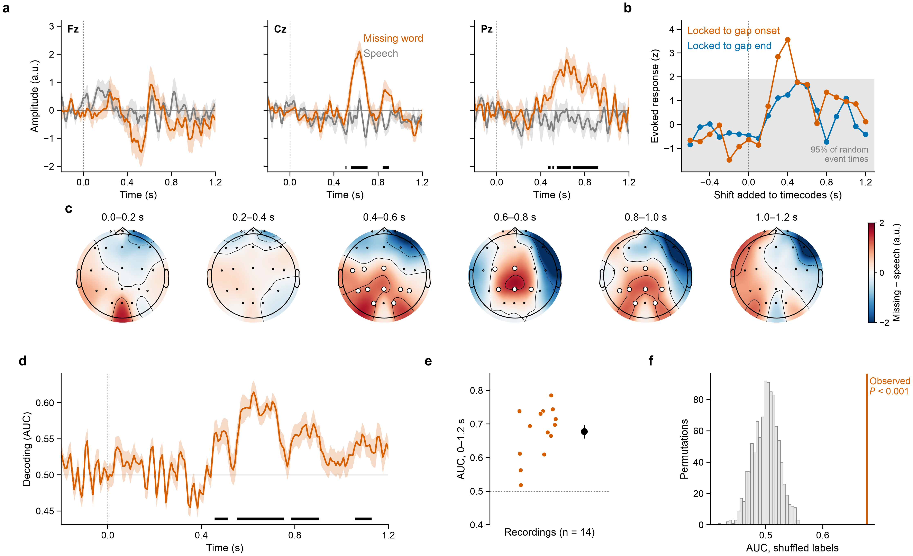
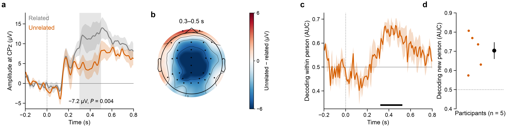
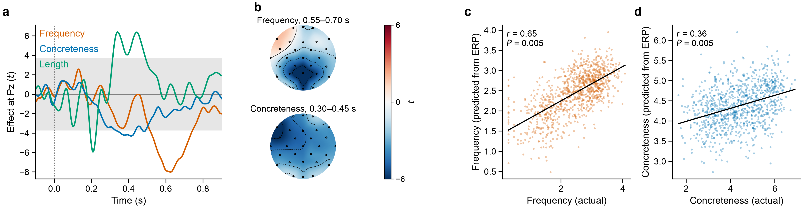

# StuckWord

EEG markers of word-finding difficulty, towards a low-channel home headband that gives a
hint when someone gets stuck on a word.

The idea: flashcard apps only see whether an answer was right or wrong. They can't tell an
instant answer from one that took ten seconds of searching, or notice that someone is on the
tip of the tongue and only needs the first letter. I want to see whether a few EEG channels
can pick up that "searching" state. Language learners are the easy place to start. People
with aphasia after a stroke, for whom word-finding difficulty (anomia) is the main problem,
are where it could matter most.

This repository has the analysis code, the stimulus files for a missing-word listening task,
the results on my EEG recordings and on two public language datasets, and the recording code
for the planned flashcard experiment with a 16-channel
[Octopus](https://docs.pieeg.com/hardware/devices/Octopus_16/) board.

## Results so far

**Missing words in natural speech (14 recordings).** Participants listened to a 5-min
Russian popular-science video in which 48 words had been cut out of the soundtrack. Compared
with moments of ongoing speech, the missing words evoked a centro-parietal positivity from
about 0.45 to 0.9 s (cluster permutation test, P = 0.0025). A linear classifier trained on 13
recordings detected the missing-word epochs in the 14th with a mean AUC of 0.68 (all 14
recordings above chance; permutation P < 0.001).



**ERP CORE N400 (5 participants).** As a check that the pipeline reproduces a known language
effect, I used part of the ERP CORE N400 data. Unrelated target words were 7.2 µV more
negative than related ones at CPz between 0.3 and 0.5 s (t(4) = −5.9, P = 0.004). The
condition could also be decoded from single trials, within a person and in a person the model
had not seen (mean AUC 0.70).



**Kiloword (960 English words).** A ridge model predicted a word's frequency (r = 0.65) and
concreteness (r = 0.36) from its ERP.



Figure legends and more details are in [results/README.md](results/README.md). All
numbers are in [results/summary.csv](results/summary.csv).

## How to run

```bash
python -m venv .venv
source .venv/bin/activate
pip install -e ".[dev,acquisition]"
```

```bash
python scripts/run_analyses.py
```

```bash
python scripts/make_figures.py
```

`run_analyses.py` takes about 3 minutes. It reads the EDF files in
`data/wordlists/MissingWords`, the N400 participants in `data/external/erpcore_n400`, and
Kiloword (25 MB, downloaded once by MNE). It saves the numbers to `results/summary.csv` and the
arrays to `results/cache/`. `make_figures.py` only reads the cache, so the figures can be
redrawn in a few seconds. The figures are saved as PNG in `results/figures/`.

The N400 analysis uses whichever participants are already on disk. To get them (about 70 MB
each):

```bash
python -c "from stuckword.datasets import download_erpcore_n400; download_erpcore_n400(subjects=range(1, 6))"
```

The project page for the PiEEG Octopus 16 Challenge is in `website/` (plain HTML, CSS and
JavaScript). It is published to GitHub Pages by `.github/workflows/pages.yml`; see
[website/README.md](website/README.md).

Tests (they use public EEGBCI eyes-open/eyes-closed recordings, about 5 MB):

```bash
pytest
```

## Data

- `data/wordlists/MissingWords/`: 14 EDF recordings (21 scalp channels, 250 Hz, ~5 min each,
  30 Mar to 1 Apr 2023). `5.edf` is a copy of `result_31.03.2023_14.12.41.edf` and is not
  used. The files contain no event markers, so the events come from the stimulus timecodes.
  Values are raw ADC counts (about 1 count per µV, not confirmed).
- `data/stimuli/missing_words_text.txt`: the transcript, with `[MASK]` for each removed word.
- `data/stimuli/missing_words_timecodes.csv`: start and end of each gap as video timecodes
  (minutes:seconds:frames, 25 frames per second).
- `data/wordlists/example_es_en.csv`: example word list for the flashcard task.

Public datasets I looked at are listed in [docs/DATASETS.md](docs/DATASETS.md).

## Planned experiment: tip-of-the-tongue during vocabulary practice

The flashcard task (`stuckword flashcards`) shows a word and records three key presses:
SPACE when the translation comes to mind (or I give up), then the answer is said aloud, then
a rating of 1 (knew it straight away), 2 (tip of the tongue) or 3 (no idea). Pressing SPACE
before speaking means the 2 s before it contain the search but no speech muscle activity.

```
Octopus --BLE/USB--> pieeg-server --lsl --> LSL "EEG" stream ---+
                                                                 +--> LabRecorder --> session.xdf
stuckword flashcards ---------------------> LSL "Markers" stream -+
```

Plan for the week with the board:

| Days | What | Code |
|---|---|---|
| 1–2 | check the signal: eyes open/closed alpha, blinks, jaw clench | `stuckword sanity-eegbci`, `sanity.py` |
| 3–4 | record ~200 flashcard trials over a few sessions | `stuckword flashcards` |
| 5 | compare tip-of-the-tongue and easy trials, find the best 3–4 channels | `stuckword analyze`, `channels.py` |
| 6–7 | move those channels into a headband, test the live hint loop | `realtime.py`, `acquisition/live.py` |

I haven't checked yet whether `pieeg-server` supports the Octopus board.

## Things to keep in mind

- Cross-validation always leaves out whole recordings or sessions, because trials from the
  same session are not independent.
- In the missing-word task, part of the response could be to the sound stopping rather than
  to the missing word itself. Comparing predictable and unpredictable missing words would
  separate the two. For that I need the list of removed words.
- I don't know yet whether the 14 recordings are 14 different people or repeated sessions.
- With 5 N400 participants, the cluster test cannot reach P < 0.05 (the smallest possible
  value is 0.0625), so only the t-test is reported there.
- Tip-of-the-tongue trials will be longer than easy ones, so reaction time has to be
  controlled for.

## Code layout

```
src/stuckword/
  acquisition/       EDF and XDF loaders, flashcard task, live LSL hint provider
  stimuli.py         missing-word timecodes, transcript, sampling of speech control times
  erp.py             cluster permutation tests, ERP features, decoding at each time point
  quality.py         bad-channel detection and muscle-burst detection
  preprocessing.py   filtering and epoching for the flashcard recordings
  features.py        band power features
  model.py           classifier and session-wise cross-validation
  channels.py        channel ranking and selection for the headband
  realtime.py        causal filter and hint detector for the live loop
  datasets.py        public dataset list and loaders (ERP CORE N400, Kiloword)
  plotting.py        figure style
scripts/
  run_analyses.py    all analyses, saves results/summary.csv and results/cache/
  make_figures.py    draws results/figures/ from the cache
tests/               pytest, uses public EEGBCI recordings
```
