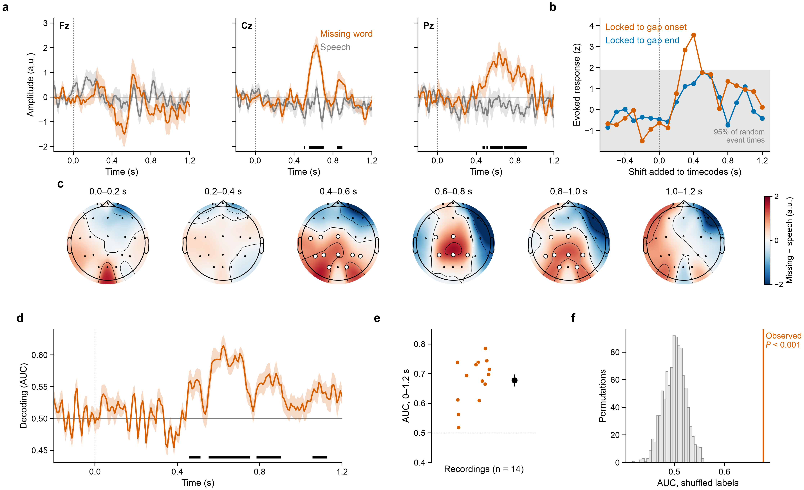
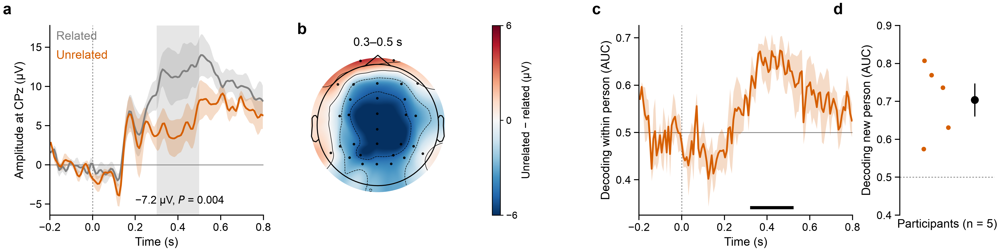
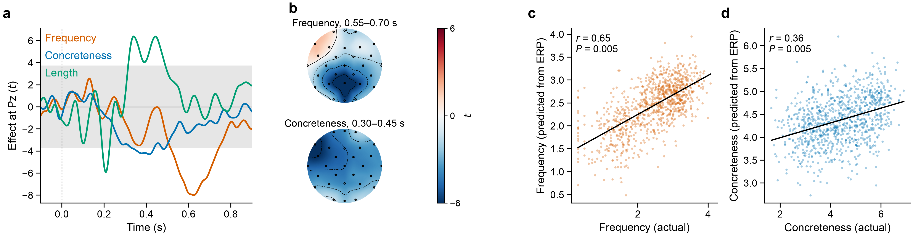

# Results

Made with `python scripts/run_analyses.py` and `python scripts/make_figures.py`. All numbers
are in `summary.csv`, and per-recording details for the missing-word task are in
`missingwords_recordings.csv`.

## Missing-word listening task

### Paradigm

The stimulus is a ~5-min Russian popular-science video about the psychology of long space
flights. 48 words were cut out of the soundtrack (`data/stimuli/missing_words_text.txt`, one
`[MASK]` per removed word). Each gap is given as a video timecode, minutes:seconds:frames at
25 frames per second (`data/stimuli/missing_words_timecodes.csv`). The gaps last 0.24–1.04 s
(median 0.58 s), occur about every 5 s between 25 s and 298 s, and match the 48 `[MASK]`
tokens in order.

There are 14 recordings of about 303 s each (30 Mar to 1 Apr 2023), with 21 scalp channels at
250 Hz. The EDF files have no event markers, so I took the event times from the timecodes and
assumed the video started when the recording started. Three files say 249 Hz in the header but
contain the same number of samples as the 250-Hz files. I treated them as 250 Hz; otherwise the
last events would be about 1.2 s off.

Conditions:
- **Missing word:** the onset of each gap, 48 per recording.
- **Speech:** 48 moments per recording from the same audio, at least 1.5 s away from any gap.

Preprocessing: 0.3–30 Hz band-pass, bad channels (mostly Fp1, Fp2 and Oz) interpolated,
average reference, epochs −0.5 to 1.5 s, baseline −0.2 to 0 s, rejection above 200 µV
peak-to-peak. Most recordings lost 0–6% of epochs; three lost 20–40%.

### Fig. 1 | Brain response to missing words in natural speech

**a**, ERPs at Fz, Cz and Pz for missing words (orange) and speech (grey), mean ± s.e.m.
across 14 recordings. Black bars: time points where the electrode is part of a significant
spatio-temporal cluster (paired cluster permutation test over 0–1.5 s, 2,000 permutations,
P = 0.0025). Amplitudes are raw ADC counts (a.u.), roughly µV.

**b**, Timing check. Evoked response strength (mean absolute grand-average ERP 50–350 ms after
the event) when the events are shifted in time, for epochs locked to gap onsets (orange) and
to gap ends (blue). Values are z-scored against 200 sets of random event times; grey shows
where 95% of the random sets fall. Only onset-locked epochs rise clearly above the random
sets, so the timecodes match the EEG and the response is to the gap itself. The best shift
(+0.4 s) reflects the latency of the response; the events were not shifted in the analysis.

**c**, Scalp maps of the missing − speech difference in 200-ms windows. White dots: electrodes
in the significant cluster.

**d**, Decoding of missing word vs speech at each time point (logistic regression on the 21
channels), tested on the recording left out of training. Mean ± s.e.m. over the 14 held-out
recordings. Black bars: above chance (one-sided cluster permutation test, P < 0.05). Peak AUC
0.61 at 0.62 s.

**e**, AUC of a classifier using mean amplitudes in 100-ms bins from 0 to 1.2 s, for each
held-out recording, with mean ± s.e.m. Mean AUC 0.68 (range 0.52–0.79).

**f**, Distribution of the mean AUC from **e** after shuffling the labels within recordings
(1,000 permutations), with the observed value (P < 0.001).

### What I take from it

The response is a late positivity over central and parietal electrodes, 0.45–0.9 s after the
gap, which looks like a P300/P600-type response to an unexpected break in the speech. It is
strong enough to be picked up in a recording the classifier has not seen before. The
contrast is still "silence where a word should be" vs "speech", so part of it could be a
response to the sound stopping. To test the language part I would compare gaps where the word
is easy to predict with gaps where it is not, which needs the removed words. I also need to
check whether the 14 recordings come from 14 different people.

## ERP CORE N400

Kappenman et al. (2021), [osf.io/29xpq](https://osf.io/29xpq/). A prime word is followed by
a target word that is either related or unrelated in meaning. I used the 5 participants I had
downloaded (sub-001 to sub-005). Preprocessing: 0.1–30 Hz, reference to the average of P9 and
P10, eye artefacts removed by regression on bipolar HEOG and VEOG channels, epochs −0.2 to
0.8 s, rejection above 150 µV. Trials kept per participant: 85, 120, 119, 66 and 114 of 120.

### Fig. 2 | N400 effect in ERP CORE

**a**, ERPs at CPz for related (grey) and unrelated (orange) targets, mean ± s.e.m. across 5
participants. The grey area marks 0.3–0.5 s, where unrelated targets were 7.2 µV more negative
(paired t-test, t(4) = −5.9, P = 0.004). With 5 participants the cluster permutation test
cannot go below P = 0.0625, so it is not shown.

**b**, Scalp map of the unrelated − related difference between 0.3 and 0.5 s.

**c**, Decoding of related vs unrelated at each time point within each participant (5-fold
cross-validation), mean ± s.e.m. across participants. Black bar: above chance (cluster
permutation test, P < 0.05), 0.32–0.52 s, peak AUC 0.67 at 0.46 s.

**d**, Decoding in a new person: a classifier trained on 4 participants (mean amplitudes
0.2–0.6 s, z-scored within each person) and tested on the 5th. Mean AUC 0.70 (range
0.57–0.81).

## Kiloword

Dufau et al. (2015), loaded with `mne.datasets.kiloword`. Each epoch is the ERP to one of 960
English words, averaged over 75 readers, with word properties attached.

### Fig. 3 | Word properties in the ERP

**a**, Regression ERP at Pz: t-values for word frequency (orange), concreteness (blue) and
length in letters (green), all in one model. Grey: not significant after Bonferroni correction
over time points.

**b**, Scalp maps of the frequency effect (0.55–0.70 s) and the concreteness effect
(0.30–0.45 s).

**c**, **d**, Frequency and concreteness predicted from each word's ERP (mean amplitudes in
50-ms bins from 0.1 to 0.7 s, ridge regression, 10-fold cross-validation) against the actual
values. Frequency: r = 0.65; concreteness: r = 0.36. Both P = 0.005, the smallest value
possible with 200 permutations.
